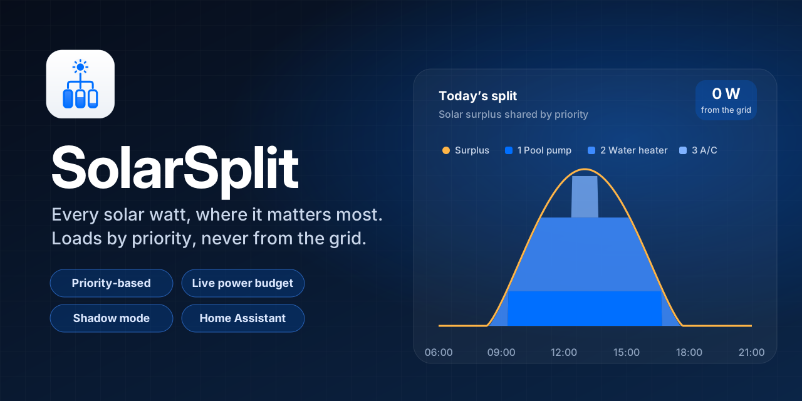

<p align="center">
  
</p>

# SolarSplit

[](https://github.com/jdgarcia99/ha-solarsplit/actions/workflows/validate.yml)
[](https://hacs.xyz)

SolarSplit is a Home Assistant integration that shares your PV surplus among loads ordered by priority (pool pump, water heater, air conditioners, radiators…). One control loop replaces the usual pairs of on/off automations: every cycle it works out how much power is available, decides which loads should run, and makes at most one change, with hysteresis and minimum on/off times.

> **Status: early development.** The control loop runs in **shadow mode**: it decides and publishes what it would do, without switching any load. Zero-injection probing, hourly net balance and services are not implemented yet. See the [design document](docs/design.md) (in Spanish) and the [changelog](CHANGELOG.md).

## How it works

Each cycle computes the available budget from smoothed grid readings:

```
budget = export − import + power of the managed loads that are on − safety margin
```

Power already used by managed loads is added back, because it can be reassigned. Loads are then walked in priority order: each one enters if it fits in what is left of the budget. The engine compares the desired and the real states and makes a single change: switch-offs first (lowest priority first), then switch-ons (highest priority first), always respecting the settle time and each load's minimum on and off times.

A load only switches on after the surplus has covered it for its switch-on delay, and only switches off after the deficit has lasted its switch-off delay. Loads regulated elsewhere are never switched but their power counts; [regulable loads](#regulable-loads), such as a water heater behind a diverter, get a power limit instead. If someone else switches a load, SolarSplit stops controlling it until it returns to the state SolarSplit set. A load that something else switches **off** (a safety cut, a person, an automation) is `blocked` with reason `switched_off`: SolarSplit never switches it back on, whatever *Respect manual changes* says, until it is on again or its **Manage** switch is turned off and on. This is not detected in shadow mode, where every switch-off comes from your automations.

When the global condition goes off, SolarSplit switches off the loads it switched on itself and that respect the condition (respecting their minimum on time); loads switched by hand and loads that ignore the condition are left alone. Turning the master switch off, instead, leaves every load as it is.

### Unknown data

Unavailable or unknown entities are unknown data, never 0 W:

- If a grid reading is missing or frozen, the cycle decides nothing: the budget is `unknown`, the last decision is `none` with reason `grid_unknown`, and every delay mark starts again. With a signed grid sensor, a reading not reported for the *stale data timeout* is frozen, whatever it reads. With separate export and import sensors, a sensor is frozen when it reads a non-zero value that has not been reported for the timeout, or when both are quiet at once: a side resting at 0 W may stay quiet, because meters only write the side that changes.
- An unknown zero-injection entity pauses the loop (`mode_unknown`).
- An unknown global condition or usage condition leaves the loads that depend on it as they are (`global_unknown`, `condition_unknown`): no switch-off, and their power is not reassigned.
- A load regulated externally whose power sensor or regulation entity cannot be read is `unavailable` and left as it is.

The loop's memory (what it switched, the time of each load's last change and the delay marks) is saved, so a reload or a restart of Home Assistant does not turn its loads into manual ones. A load changed while Home Assistant was stopped is detected as manual. Delay marks older than two minutes are dropped on restart.

All SolarSplit entities get the label **Gestión de excedentes**, created if it does not exist.

### Shadow mode

Shadow mode is **on by default**. The loop runs every cycle and updates all its entities, but never calls a service on a load. Compare its decisions with your current automations for a while, then turn shadow mode off in the integration's settings. Turning a load's **Manage** switch off, or the master switch off, hands the load back to your automations at any time.

Planned: zero-injection mode (probing loads when the inverter limits export), hourly net balance mode and `force_on` / `force_off` / `recalculate` services.

## Entities

The **SolarSplit** device:

| Entity | Description |
| --- | --- |
| Surplus management (switch) | Master switch. Off: the loop leaves every load as it is. |
| Available budget (sensor, W) | Budget of the last cycle. |
| Assigned power (sensor, W) | Power of the managed loads that are on. |
| Mode (sensor) | `normal`, `zero_injection` or `paused`. |
| Last decision (sensor) | `none`, `turn_on` or `turn_off`; attributes `load`, `reason`, `budget` and `shadow` (true if it was only simulated). |

One device per load:

| Entity | Description |
| --- | --- |
| Manage (switch) | Include or exclude the load without deleting it. |
| State (sensor) | `on`, `off`, `waiting` (a change is wanted), `blocked`, `manual`, `unmanaged` or `unavailable`. |
| Reason (sensor) | Why, for example `no_budget`, `on_delay`, `min_on_time` or `not_eligible`. |
| Priority (number) | Applied on the fly, without reloading; also stored in the load's settings. |
| Time on today (sensor, h) | Hours the load has been on today, counted by SolarSplit from the load's state (whoever switched it). Resets at local midnight and survives restarts. |
| Request active (binary sensor) | On-demand loads only: on while a request is active. |

Diagnostics (on the integration's menu) include the settings, every load and the last cycle.

## Installation

1. In HACS, add `https://github.com/jdgarcia99/ha-solarsplit` as a custom repository of type *Integration*.
2. Install **SolarSplit** and restart Home Assistant.
3. Go to **Settings → Devices & services → Add integration → SolarSplit**.

## Try it in shadow mode

There are no releases yet: HACS installs the latest commit of `main` and shows its short hash as the version. Every new commit on `main` appears in HACS as an update. In shadow mode SolarSplit never calls a service on a load, so your current automations keep doing the real work while you compare.

The UI follows Home Assistant's language; Spanish labels are given in brackets.

### 1. Add the repository to HACS

1. Open **HACS**, click **⋮** (top right) → **Custom repositories** (*Repositorios personalizados*).
2. **Repository**: `https://github.com/jdgarcia99/ha-solarsplit` · **Type**: **Integration** (*Integración*) → **Add**. Close the dialog.
3. Search HACS for **SolarSplit**, open it and click **Download** (*Descargar*). Keep the version it offers (the latest commit of `main`) and confirm.
4. Restart Home Assistant: **Settings → System → ⏻ → Restart Home Assistant** (or the repair HACS raises).

To update later, download the update HACS shows and restart again. The loop's memory survives restarts.

### 2. Create the integration

1. **Settings → Devices & services → Add integration**, search for **SolarSplit**.
2. Fill in:
   - **Grid export sensor**: power exported to the grid, in W (for example `sensor.meter_export_to_grid`).
   - **Grid import sensor**: power imported from the grid, in W, from the same meter.
   - Or, instead of those two, a **Signed grid power sensor** with its **Sign** (export negative or positive). Use one mode or the other, not both.
   - **Global condition** (*Condición global*): `input_boolean.casa_activada`.
   - **PV power sensor** and **Zero-injection mode entity**: optional. Zero-injection probing is not implemented yet; while that entity is on, the loop pauses and leaves every load alone.
   - Keep the loop defaults (5 s cycle, 100 W safety margin, 30 s smoothing and settle time, 100 W switch-on margin, 150 W import tolerance, 20 s stale data timeout).
   - **Shadow mode** (*Modo sombra*): **leave it ticked**.
3. Submit. A **SolarSplit** service device appears with the master switch and the loop sensors.

### 3. Add each load

On **Settings → Devices & services → SolarSplit**, click **Add load** (*Añadir carga*) once per device. An entity can belong to one load only, so a group of devices switched together needs one entity (a group or a template switch) or one load each.

| Field | What to enter |
| --- | --- |
| **Name** | As you want to see it, e.g. *Depuradora*. |
| **Load type** | *Relay* for everything SolarSplit switches; *Regulable* for the water heater behind the diverter (see below). |
| **Entity** | The `switch`, `input_boolean` or `climate` entity that turns it on and off. |
| **Nominal power** | What it really draws when on, in W. |
| **Power sensor** | Its power meter, if it has one: used instead of the nominal power. |
| **Priority** | 1 is served first. |
| **Do not skip** (*No saltar*) | Tick on loads that may only start when every eligible load before them is on (today's rule for the air conditioners). |
| **Switch-on / switch-off delay** | The delays your automations use today (`for:` of their triggers). |
| **Minimum on / off time** | Protection for compressors and pumps; keep at least 5 min for air conditioners and the pool pump. |
| **Respect the global condition** | Untick for loads that must keep running with the house empty, such as the pool pump. |
| **Usage condition entity / state** | E.g. `input_boolean.climatizar_casa` / `on` for the air conditioners. |
| **Respect manual changes** | Leave ticked. |
| **Climate mode when on** | Only for `climate` entities (usually `cool`). |
| **Regulated externally when** | Leave empty (it was for the heater with FreeDS; the heater is now a regulable load). |
| **Daily target** | For the pool pump: *Hours on today sensor* `sensor.piscina_on_hoy` and a *Target hours entity* with today's hours. The hours per season live in `input_number.horas_invierno_piscina` and `input_number.horas_verano_piscina`, chosen by `input_select.temporada_piscina`: give SolarSplit one entity, such as a template sensor helper that picks the right one. |

#### The water heater with the x10derivador

The heater's diverter (x10derivador, ESPHome) regulates the heater itself, aiming at a grid target (`number.coladuria_x10_derivador_objetivo_de_red`, −50 W: it keeps about 50 W of export). SolarSplit does not switch it; it lets the diverter take the surplus that the loads ahead of it leave, by writing the diverter's maximum power. Add it as a regulable load:

| Field | Value |
| --- | --- |
| **Name** | Termo |
| **Load type** | Regulable |
| **Entity** | `switch.termo` (the Shelly Pro 1PM in front of the diverter). SolarSplit never switches it; while it is off the heater is `blocked`. |
| **Nominal power** | 1600 W |
| **Power sensor** | `sensor.termo_power`: the Shelly's real measurement, not the diverter's estimate (`sensor.coladuria_x10_derivador_potencia_al_termo_estimada`). |
| **Priority** | After the loads that must get the surplus first (for example 2, after the pool pump). With priority 1 it stays at its maximum and takes the surplus first. |
| **Respect the global condition** | Ticked: with the house empty SolarSplit stops limiting it and gives it its maximum back; the diverter keeps regulating on its own. |
| ***Regulable load* section** | |
| Limit entity | `number.coladuria_x10_derivador_potencia_maxima` |
| Mode entity | `select.coladuria_x10_derivador_modo` |
| Automatic mode value | `Auto` (the other options, `Manual` and `Apagado`, make the load `external`: its power is grid power) |
| Minimum / maximum limit | 0 / 1600 W (the heater's element) |
| Smallest change written / minimum time between writes | 100 W / 30 s |

Leave `switch.coladuria_x10_derivador_modo_manual`, the grid target and `sensor.coladuria_x10_derivador_consigna` to the diverter: SolarSplit only reads the mode select and writes the maximum power.

> **Safety.** The heater's protection (the Shelly cutting `switch.termo`) is independent of SolarSplit and must stay that way: SolarSplit never implements it, never switches `switch.termo`, and while it is off the heater is `blocked`. SolarSplit can only lower the diverter's maximum power, and it gives it back when it stops managing the heater.

Every load gets its own device with **Manage**, **State**, **Reason** and **Priority**. To change a load later, use its **⋮ → Reconfigure** on the integration page; the integration reloads without losing its memory. Priority can also be changed from its entity, at once.

### 4. Watch it for a week or two

- **Last decision**: its history shows every `turn_on` / `turn_off` SolarSplit would have done, with `load` and `reason` attributes. Compare it with what your automations did.
- **State** and **Reason** of each load: `waiting` means it wants a change and the reason says what holds it (`on_delay`, `min_on_time`, `settling`…); `blocked` with `no_budget` or `waiting_higher` explains why a load stays off; `global_shutdown` means it would be switched off because the global condition is off.
- **Available budget** next to your export sensor in a history graph: it should follow the surplus without jumping with every cloud.
- **Diagnostics** (integration page → **⋮ → Download diagnostics**) when something looks wrong: settings, memory of every load and the last cycle.

Tune delays, margins and priorities until the decisions match what you expect. Global settings are under the integration's **Configure** button.

### 5. Hand over a load (later)

Turn **Manage** off on every other load, disable the automations of the load you hand over, and untick **Shadow mode** in **Configure**. The master switch, or a load's **Manage** switch, gives control back to your automations at any time.

## Settings

All settings live in the UI; there is no YAML. They can be changed later from the integration's **Configure** button.

| Setting | Default | Description |
| --- | --- | --- |
| Signed grid power sensor | none | One sensor with the grid power (W), export and import with opposite signs. Use either this one or both the export and import sensors. |
| Sign of the grid sensor | export negative | Whether the signed sensor shows export as negative or positive. |
| Grid export sensor | none | Power exported to the grid (W). With the import sensor, instead of a signed sensor. |
| Grid import sensor | none | Power imported from the grid (W). With the export sensor, instead of a signed sensor. |
| PV power sensor | none | PV production (W). Needed for zero-injection mode. |
| Zero-injection mode entity | none | When on, the loop probes loads instead of reading export. |
| Global condition | none | When off, the loop switches off the loads it switched on that respect it, and leaves the rest as they are. |
| Season entity | none | `input_select` or `select` with the current season. Loads can be limited to some of its options (see *Manual control and season*). |
| Cycle interval | 5 s | How often the control loop runs. |
| Safety margin | 100 W | Power never handed out to loads. |
| Smoothing window | 30 s | Moving average applied to the readings. |
| Settle time | 30 s | Wait after a change before the next one. |
| Switch-on margin | 100 W | Extra power a load needs, above its own, to be switched on. |
| Import tolerance | 150 W | Grid import tolerated before a load is switched off. |
| Stale data timeout | 20 s | A non-zero grid reading not reported for longer, or both grid sensors quiet at once, counts as unknown. 0 disables the check. |
| Shadow mode | on | Decide and publish decisions without switching any load. |

## Loads

Each load is a subentry: on the integration's page, use **Add load**, and edit or delete it from its menu. An entity can belong to one load only.

| Setting | Default | Description |
| --- | --- | --- |
| Name | — | Shown on the load's device. |
| Load type | relay | **Relay**: switched on and off. **Regulable**: regulates itself (a diverter); SolarSplit only writes its power limit. See [Regulable loads](#regulable-loads). |
| Entity | — | `switch`, `input_boolean` or `climate` entity that turns the load on and off. For a regulable load, the switch in front of it: never switched by SolarSplit; while it is off the load is blocked. |
| Nominal power | — | Power drawn when on (W). |
| Power sensor | none | Measured power; used instead of the nominal power when set. Required for a regulable load. |
| Priority | 10 | 1 is served first. |
| Do not skip | off | Only switch on when every eligible load before it is on. |
| Switch-on delay | 60 s | The surplus must cover the load this long before it is switched on. |
| Switch-off delay | 30 s | The deficit must last this long before the load is switched off. |
| Minimum on / off time | 5 / 5 min | Protects compressors and pumps. |
| Respect the global condition | on | When the global condition is off, switch this load off if SolarSplit switched it on (after its minimum on time); otherwise leave it as it is. |
| Usage condition entity / state | none / `on` | The load is only used while that entity has that state. |
| Respect manual changes | on | If someone else switches the load, stop controlling it until it returns to the state SolarSplit set. Ignored for on-demand loads. |
| Climate mode when on | cool | For `climate` entities. |
| Regulated externally when | none | Relay loads only. While this entity is on, the load is never switched but its power counts. |

The **Manual control and season** section of the form (collapsed unless one of them is set):

| Setting | Default | Description |
| --- | --- | --- |
| Only on demand | off | The load is only used while someone asks for it (see below). Replaces *Respect manual changes*. Relay loads only. |
| Manage again automatically | off | When **Manage** is switched off, it switches back on by itself when the load goes off, or at the time below, whichever comes first. |
| Manage again at | 00:00 | Local time at which Manage switches back on. |
| Seasons | all year | Options of the season entity in which the load is used. Shown only when a season entity is set; empty: all year. |

- **On demand.** Switching the load on from anywhere but SolarSplit (a person, an automation, a remote) starts a **request**; switching it off from anywhere but SolarSplit ends it. While the request lasts, the load is managed with its priority: SolarSplit switches it off when the surplus runs out (after its delays and minimum on time) and back on when the surplus returns; that switch-off does not end the request. Without a request it is never switched on, even first in line with surplus (reason `waiting_request`), and its power is the house's. A climate gets back, when switched on again, the HVAC mode, target temperature and fan mode that were set when it was asked for, not the load's *Climate mode when on*. The request is kept across restarts; the binary sensor **Request active** shows it. In shadow mode requests are followed the same way and the decisions are only published.
- **Manage off.** While Manage is off the load's power is not reassigned: it counts as the house's consumption.
- **Season.** Out of season the load is not used (reason `out_of_season`) and, if SolarSplit switched it on, it is switched off at once (no switch-off delay; its minimum on time is respected); a load someone else switched on is left as it is. A regulable load gets its minimum limit. The season and the usage condition must both hold. While the season entity cannot be read, the load is left as it is (`season_unknown`).

The **Daily target** section of the form (collapsed unless a target is set):

| Setting | Default | Description |
| --- | --- | --- |
| Hours on today sensor | none | Hours the load has been on today (`h`, `min` or `s`). Empty: SolarSplit's own count, the load's *Time on today* sensor. |
| Target hours entity | none | `input_number`, `number` or `sensor` with the hours wanted today. Takes precedence over the fixed value. |
| Target hours | 0 | Fixed hours wanted per day when there is no target entity. 0: no daily target. |

Once the hours on today reach the target, the load is not eligible until the next day (reason `target_reached`): SolarSplit switches it off after its minimum on time, and it stays `blocked` even if the target is raised later that day. A regulable load gets its minimum limit instead. Turning **Manage** off and on clears it. While the hours or the target cannot be read, the load is left as it is (`condition_unknown`).

The **Regulable load** section of the form (collapsed unless the type is Regulable):

| Setting | Default | Description |
| --- | --- | --- |
| Limit entity | — | `number` or `input_number` with the device's maximum power. |
| Mode entity | — | `select`, `input_select`, `switch` or `input_boolean` with the device's mode. |
| Automatic mode value | `Auto` | State of the mode entity that means automatic. |
| Minimum / maximum limit | 0 / 2000 W | SolarSplit never writes outside this range, and writes the maximum back when it stops limiting the load. |
| Smallest change written | 100 W | A new limit is written only if it moves by at least this much, or reaches the minimum or maximum. |
| Minimum time between writes | 30 s | So the device is not flooded with writes. |

### Regulable loads

A regulable load regulates its own power, like a diverter that sends the surplus to a water heater. SolarSplit never switches it; it reads its power and writes its power limit.

- **Automatic mode** (the mode entity has the automatic value): the load's measured power is surplus. It counts in the budget like any managed load, and the load takes its turn in the priority walk:
  - If nothing ahead of it uses or is about to use the budget (it has the highest priority, or the loads ahead are off and stay off), its limit is its **maximum** (reason `full_power`).
  - Otherwise its limit is what the loads ahead leave, within the minimum and maximum (reason `limited`). The limit is rounded down to the entity's step.
  - With its usage condition off, its limit is the minimum (`not_eligible`).
  - Loads after it get what it does not use.
- **Any other mode** (Manual, Off…): its power is grid power. It is not reassigned and the load is shown as `external`.
- **Its switch off** (a safety cut, for example): `blocked` with reason `switched_off`.
- **Giving it back:** when SolarSplit stops limiting a load it lowered (master switch off, Manage off, other mode, global condition off, integration unloaded or disabled), it writes the maximum back at once.
- If its power, limit or mode cannot be read, it is `unavailable` and nothing is written.

The State sensor of a regulable load has a `limit` attribute with the limit it should have. In shadow mode nothing is written; the attribute shows what would be. Limit writes do not count as the cycle's one switching action.

## License

[MIT](LICENSE)
